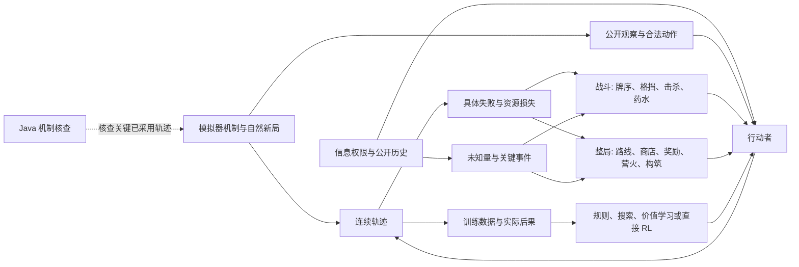

# 杀戮尖塔自主玩家研究图谱

长期目标是让玩家在自然 A20H 局面中持续作出有质量的决策：打得过当前战斗，也保留足够血量、药水、金币、卡组强度和路线机会进入下一场。现在的公开玩家尚无这样的能力。近期先研究第一幕；路线图描述要研究的因果关系和可选方法，具体 seed、实验数字与版本保存在实验 artifact。模拟器机制、运行和跨端证据分别见[策略研究边界](architecture/strategic-agent.md)、[RUNBOOK](RUNBOOK.md)与[架构](ARCHITECTURE.md)。

## 近期判断：第一幕通过与卡组状态一起看

当前比较玩家的两个主轴是：能否在自然 A20H 前序通过第一幕；抵达 Boss 或第二幕时，卡组是否仍有可发展的战斗能力。只看通关会奖励乱抓过渡牌、随意交药；只看理想卡组会奖励冒险跳过眼前必需的战力。失败局也保留死亡节点、当时卡组和资源，不能只从通过的局里挑好看的卡组。两轴并列呈现，不先造一个加权总分或声称局部改动必然单调改善。

卡组状态要结合面对的战斗检查：对当前精英和第一幕 Boss 的输出速度、群攻需求、防御与爆发回合、过牌和费用、状态牌处理，以及冗余牌是否稀释关键牌。血量、具体药水、金币、遗物、营火和后续路径随结果一起记录；它们影响下一幕机会，但不能以单一“剩余药水数”代替。是否有足够的第二幕能力仍是待检验判断，不由静态卡牌分数直接给出。

因此战斗搜索先负责检验具体打法与资源结算：能否击杀、预计承受多少伤害、是否必须交某瓶药，以及本回合动作怎样改变后续抽牌或持续效果。地图规划负责在公开地图的可达路线之间比较遭遇顺序、卡组对精英/Boss 的准备程度、商店与营火的补救机会和资源余量，并在战斗和奖励后重评。二者需要交换资源后果与遭遇需求；“下一格是精英”或某个固定 HP 比例不能单独决定路线、休息和交药。

现有 `rule-search` 只在少数可见直接伤害/格挡牌上寻找即时击杀或可见致命攻击的解法；其余战斗和战略选择仍依赖静态规则，其中存在未经整幕验证的 HP 阈值。这是当前实现事实，不是目标架构。阈值可用于明确的机制边界（例如本回合伤害会致死），但经验性的休息线、精英线、药水保留线不能仅凭一次局部案例新增或认定有效。

## 信息权限是四种不同的问题

| 层级 | 决策时能知道什么 | 回溯与试探 | 适合回答的问题 |
| --- | --- | --- | --- |
| No SL | 当前公开观察、此前实际见过的公开历史、由这些信息推导的概率与机制 | 不读取本局真实暗牌序或 RNG，也不把实际试探结果带回；可以在内部按公开信息做假设推演 | 一个不能读档的玩家在不确定性下如何行动？ |
| Native SL | No SL 的信息，加上游戏原生存档允许的试探记忆 | 在原生保存边界重进并尝试别的动作；可复用的知识取决于回退范围和随机状态是否仍相同 | 原生读档能挽回哪些战损和选择？ |
| 节点式 Seed-SL | 公开信息、明确来源的历史试探，以及可恢复的旧节点 | 从选定节点重新探索，不必从 Neow 逐步精确复现；仍须记录知识适用的动作路径与随机条件 | 较自由的分支试验能找到什么策略？ |
| Oracle | 完整真实状态，包括隐藏牌序和 RNG | 可直接计算固定状态的后继 | 机制是否正确、固定局面是否存在更好打法、非先知方法距离上界多远？ |

这是**权限划分**，不直接规定算法。No SL 可以搜索公开信息下的可能世界，却不能让搜索读到这局真实隐藏世界。Native SL 与节点式 Seed-SL 都能试出新信息；同一个 seed 或相同画面并不保证改动后的分支仍沿用旧牌序。Oracle 可做诊断，不能把它的最佳动作直接当作公开策略的训练标签或成绩。

原生可回退的精确范围由[原生保存边界](architecture/original-save-boundaries.md)和实际机制决定；“在这一层内”是直观说法，不是对所有画面均可任意回到层首的保证。四层可使用同一个游戏环境，但策略的观察、记忆、搜索入口和结果报告必须区分。

## 研究对象之间怎样相连

中心对象是**一位持续行动的玩家及其自然轨迹**，而不是某个孤立求解器。第一幕能多走几层但花光药水、把过渡攻击塞满牌库，可能使第二幕更难；一场精英以 1 血打赢，也可能迫使下一火休息并损失升级。因此要把战斗、资源和跨幕构筑放在同一条时间线上看。

当前 `rule-search` 是可运行的公开玩家，但战斗搜索只处理少数可见直接伤害／格挡牌，而且主要接管本回合斩杀或可见致命攻击。它不是完整战斗策略。两个 bootstrap lane 只用于合法覆盖与终止诊断，不能与 `rule-search` 并列解释为质量基线。固定完整状态求解器、信息候选搜索和旧模型都可作为研究材料，是否延用取决于自然轨迹中的实际贡献。

## 六个相互耦合的研究问题

| 问题 | 要看见的具体差异 | 候选方法与难点 |
| --- | --- | --- |
| 1. 环境是否可信 | 同一已采用动作在 Rust 与 Java 的关键结算是否一致；公开观察有没有漏掉玩家本可见的信息 | 对真实访问频繁的牌、怪、事件抽样审计；最小 mismatch 修机制 owner。Rust 策略成绩与 Java parity 分开报告。 |
| 2. 玩家知道什么 | 摸牌、洗牌、置顶、事件试探和回退后，哪些知识仍成立 | 用动作及观察历史维护部分牌序和来源条件；未知处保留 Unknown。节点式 SL 的试探记录与实际提交轨迹分开。 |
| 3. 一场战斗怎样打 | 同一战斗能否更少失血、少交药；当前回合好看是否换来下回合坏抽牌 | 从可见本回合的击杀／防御扩展到完整回合边界、关键抽牌条件和后续威胁；比较可执行的条件策略，而非各隐藏世界各自的先知胜线。 |
| 4. 资源怎样跨场景流动 | 精英掉血如何改变营火、路线和 Boss；今天的一瓶药能否避免明天被迫休息或死亡 | 保留 HP、药水具体种类、金币、卡组和地图机会的后效；先研究有真实分歧的少数节点，再扩大到整局估值。 |
| 5. 卡组如何跨幕 | 第一幕过渡牌帮助赢早期战斗，却可能稀释第二幕启动；力量、消耗、格挡、过牌是否能形成可运转结构 | 追踪抓牌和删牌的边际作用、牌序与费用瓶颈；比较跨幕自然轨迹，不用静态单卡分数断言构筑质量。 |
| 6. 怎样获得泛化能力 | 修一条 seed 后，新的 seed 和后续幕是否仍改善 | 规则 bot、搜索、价值模型、动作提议模型和直接 RL 都是候选；训练资料必须带信息权限及实际后果，独立 seed 上看完整轨迹。 |

这些问题会互相反馈。例如交药时机看似战斗策略，实际还取决于剩余路线和下一场可得到药水的机会；路线偏好又取决于卡组能否低战损打精英。不能只凭平均楼层或一场胜负给这些决策定性。

## 抽牌不确定性：从关键事件入手

普通均匀蒙特卡洛不是充分的答案：少量样本容易漏掉“首回合抽到 Evolve 才可能应对二回合塞牌”这样的高影响事件，并把稀有失败误报为安全。但也不必断言所有采样都无效。研究单位应是**信息条件下的关键事件及其后续分支**：

1. 先列出可公开表达的条件，如“第一回合能否摸到 Evolve”“在交 Swift Potion 后能否同时摸到防御和输出”。条件必须用牌堆组成、已知牌顶和公开历史定义，不能偷窥真实牌序。
2. 简单无放回抽牌可精确计数；一旦有过牌、洗牌、塞牌、遗物或敌方变化，就按新增观察继续分支。分层枚举或重要性采样可专门覆盖少见但高损失的分支，并保留各分支的概率依据。
3. 每个动作比较实际可执行的后续政策：先共同决定，看到新牌以后再区别行动。报告死亡、战损分布和用药，而非只给平均伤害或“搜索到一条胜线”。
4. 若候选模型尚不能正确表示关联的 RNG、事件或敌方意图，就把这一部分的结论标为假设或 Unknown。Oracle 固定状态反例帮助发现漏掉的打法，但不能填补公开后验。

因此搜索可以是精确局部枚举、带条件分支的树、规则引导的有限展开、学习价值辅助的搜索，或它们的组合；也可以让直接 RL 作独立对照。方法由失误类型决定，增加候选数和预算本身不保证改善。

## 从哪里取得下一轮反馈

先让现有公开玩家在**自然 A20H** 局面连续行动，保存每层路线、入场与离场 HP、具体药水、金币、选牌、营火和战斗动作。A0 可隔离机制及覆盖问题，但它不代替 A20H 的资源判断。把死亡前的多个损失节点串起来看：哪一步是当时已可见的失误，哪一步依赖未知牌序，哪一步是前面构筑或资源选择的后果；无法确定的因果关系保留为 Unknown。

随后在同一信息权限下比较候选动作或策略，特别关注精英与 Boss 的高战损战斗、药水使用窗口、商店花钱与跳过、营火休息对升级机会的影响。SL 与 Oracle 的试探可以帮助找具体反例和上界，但它们的结果另列，不与 No SL 自然表现混算。改进接回连续玩家后，再观察是否只是把失败推迟到下一幕。

短期最有价值的产物不是一组空泛规则，而是可复核的“公开观察 → 选择 → 资源后果 → 候选解释 → 新策略再运行”的案例，以及越来越多跨幕自然轨迹。最终 A20H 心脏胜率、坏局生存、资源保留和计算成本都要在独立 seed 上呈现；一把精彩胜局只说明存在一条轨迹。
